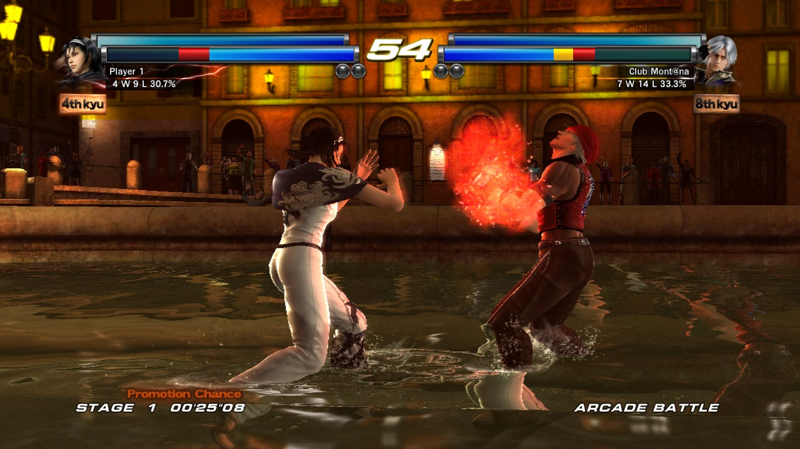
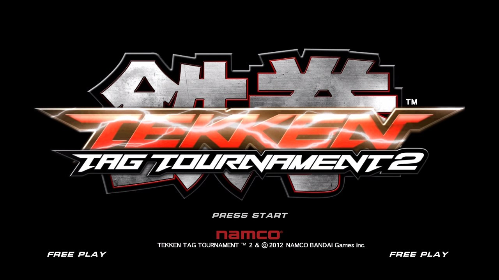
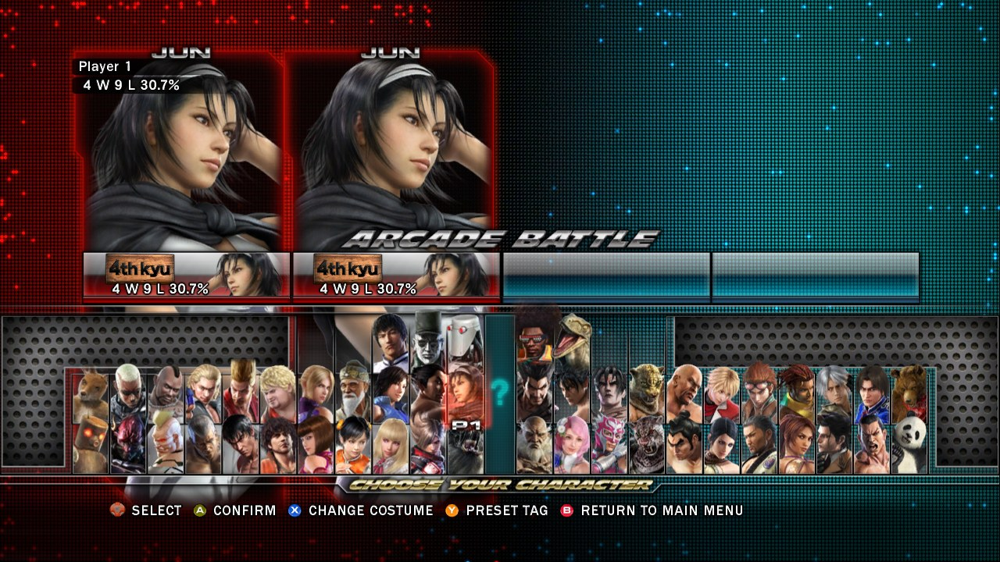
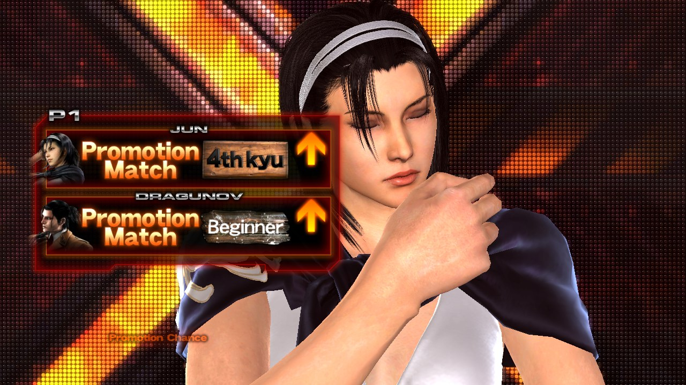
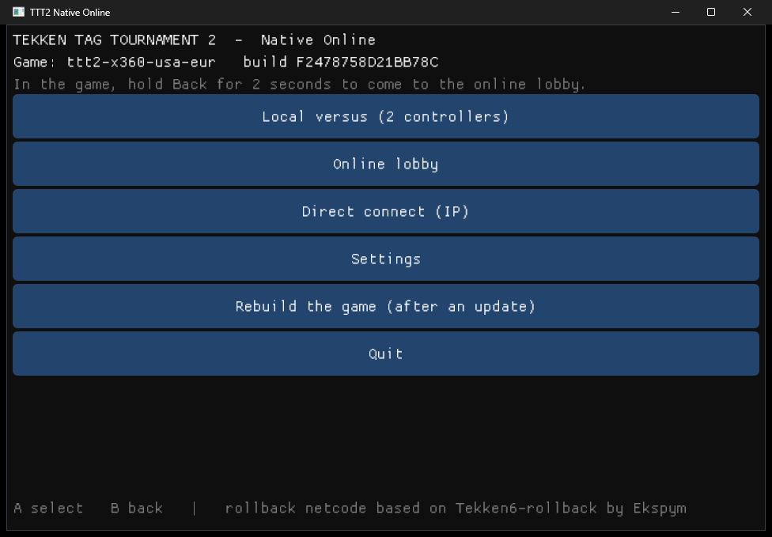

# TTT2 Native Online

A native Windows port of **Tekken Tag Tournament 2** (Xbox 360), with **rollback netcode**
and a **serverless online lobby**. Controllers only, up to two.

The game is not emulated. Setup statically recompiles the game's PowerPC code into C++ and
compiles it on your PC, then runs it on a small native runtime that stands in for the Xbox 360
kernel. Nothing from the game ships with this project. You need your own disc, and setup checks
that you have it.



> **Status: early development.** The recompiled game runs natively at 60 fps with a Direct3D 11
> renderer: menus, character select, intros and fights all draw. Local versus works, and online
> matches run in lockstep (in sync, but with input delay). Rollback in fights is still being
> finished, and music and voices are silent. See [docs/STATUS.md](docs/STATUS.md) for what works
> and what's next.

## Screenshots

| | |
| --- | --- |
|  |  |
| Title screen | Character select |
|  |  |
| Round intro | The launcher (controller navigation) |

Screenshots are from the native build on a PC, using the author's own copy of the game.

---

## Requirements

- Windows 10 or 11, 64-bit
- A CPU with AVX2 (most CPUs since 2013)
- Your own **Tekken Tag Tournament 2 (USA, Europe)** Xbox 360 disc image (a 1:1 dump, `.iso`),
  or the extracted disc folder
- About 12 GB of free space (8.3 GB of game data plus the build)
- An internet connection for the first setup (it downloads a portable compiler, about 250 MB)
- One or two controllers (Xbox, PlayStation, Switch Pro and most other pads work)

## Installation (first time only)

1. Download the latest release and extract it into its own folder. Avoid `Program Files`.
2. Put your disc image in the **`iso`** folder. Optionally, put your own title update and DLC
   packages in the **`dlc`** folder (see below).
3. Run **`TTT2 Native Online.exe`** and choose **Set up the game**. You can also run
   **`Setup.bat`** directly (from a copy of the source code, which has no launcher yet: setup
   builds it and puts `TTT2 Native Online.exe` in the folder, next to `Setup.bat`).
4. Setup then runs on its own, which takes about 5 to 10 minutes. It:
   - verifies every game file against known checksums while copying it into `native\game`
     (other versions or modified dumps are refused)
   - downloads a portable compiler toolchain into `native\toolchain`, with every download checked
     by SHA-256
   - builds the recompiler, translates `Default.xex` to C++ and compiles the game into
     `native\bin`
5. That's it. The launcher starts the native game from then on.

Nothing is installed on your system. Everything stays inside this folder, and deleting the
folder removes it completely. A log of the build is written to `native\build.log`.

After an update that changes game code, choose **Rebuild the game**. Your verified game data is
kept, so you don't need the ISO again.

### Title update and DLC (optional)

Copy the package files from your Xbox 360 into the **`dlc`** folder as they are. Subfolders are
fine. Setup checks every package against its own hashes and only accepts packages for this game.

- **Title update:** Title Update 3 (the newest; it includes the earlier ones) is applied to
  `Default.xex` before the game is translated. Older updates are ignored.
- **DLC:** each package is installed into `native\dlc` and the game sees it as installed
  content, e.g. the Bonus Tracks packs.

After adding or removing packages, choose **Rebuild the game** (or run `Setup.bat -Rebuild`).
For online play both players need the same title update; the lobby only pairs identical builds.

## Playing

Everything in the launcher works with a controller: D-pad or stick to move, **A** to select,
**B** to go back. Text such as your name or an IP address is typed on an on-screen keyboard.

- **Local versus**: two controllers on one PC.
- **Online lobby**: see who's online with the same game build, check their ping, and challenge
  them. A match starts when they accept.
- **Direct connect**: enter your opponent's IP address, for LAN play, a forwarded port or a VPN
  such as Tailscale.

At start the launcher asks GitHub whether a newer release exists and, if so, says so in the main
menu with a button to the download page. Settings can turn this check off.

### Netcode

Online matches use **rollback netcode** in the style of GGPO, following the approach of
[Tekken6-rollback](https://github.com/Ekspym/Tekken6-rollback) by Ekspym:

- Each side predicts the opponent's input instead of waiting. When a prediction turns out to be
  wrong, the game rewinds to the first wrong frame and re-simulates up to the present.
- The input delay is set automatically: 1 frame up to about 100 ms ping, plus one frame per
  additional 50 ms.
- Rollbacks are capped at 5 frames. On a worse connection the game briefly waits instead of
  predicting further.
- Both players must have an identical build, so the lobby only shows compatible players.
- Desyncs are detected with checksums of confirmed frames.

A wired connection is recommended.

### The lobby has no server

Players find each other through public WebTorrent trackers. These only pass connection offers
between players who announce the same room. The match itself is a direct WebRTC connection
between the two players, using STUN to get through home routers. If you can't connect because
of a strict NAT, you can set a TURN server in `.env`.

To play only with friends, pick a private room name in **Settings**.

## Configuration

Optional settings go in a `.env` file next to `Setup.bat`. Copy `.env.example` and uncomment
what you need: player name, lobby room, netplay port, input delay, trackers, STUN/TURN servers,
and the number of build jobs. `.env` is git-ignored.

## Building from source (developers)

See [docs/BUILDING.md](docs/BUILDING.md). In short: Clang 18 or newer, CMake 3.24 or newer and
Ninja, or let `Setup.bat` fetch them. The launcher and tests build without any game files. The
game itself can only be built by `Setup.bat` from your own copy.

```
cmake -S . -B build -G Ninja -DCMAKE_C_COMPILER=clang -DCMAKE_CXX_COMPILER=clang++
cmake --build build
ctest --test-dir build
```

## How it works

| Piece | What it does |
| --- | --- |
| `tools/setup` | First-time setup: verifies and extracts your disc (XDVDFS reader), fetches the toolchain, runs the build |
| `tools/tt2-analyze` | Finds everything the recompiler needs in *your* `Default.xex`: register save/restore helpers, around 600 jump tables, function boundaries, kernel imports |
| `tools/recomp-patches` | Fixes for [XenonRecomp](https://github.com/hedge-dev/XenonRecomp): about 70 PowerPC/VMX instructions this game uses that upstream doesn't implement yet, plus loader and division fixes |
| `src/runtime` | The native runtime: guest memory, the Xbox 360 kernel and XAM functions the game imports, threads and synchronization, file system, controllers, audio, the GPU command processor, a Xenos-to-HLSL shader translator and the Direct3D 11 renderer |
| `src/netplay` | Rollback session, UDP and WebRTC transports, P2P lobby |
| `src/runtime/rollback` | Per-frame snapshots of the game's memory, tracking changed pages with page protection |
| `src/launcher` | The controller-driven launcher |

More detail: [docs/ARCHITECTURE.md](docs/ARCHITECTURE.md) and [docs/NETPLAY.md](docs/NETPLAY.md).

## Credits

- **[Tekken6-rollback](https://github.com/Ekspym/Tekken6-rollback)** and
  **[Tekken6-native-online](https://github.com/Ekspym/Tekken6-native-online)** by **Ekspym**:
  this project's rollback design and first-time setup follow them.
- **[XenonRecomp](https://github.com/hedge-dev/XenonRecomp)** by hedge-dev (MIT), the Xbox 360
  static recompiler.
- **[Unleashed Recompiled](https://github.com/hedge-dev/UnleashedRecomp)** by hedge-dev (GPL-3.0),
  a reference for the recompiled-game runtime.
- **[Xenia](https://github.com/xenia-project/xenia)** (BSD-3-Clause): years of Xbox 360 research,
  including kernel behavior and the GPU command format.
- **[GGPO](https://github.com/pond3r/ggpo)** by Tony Cannon, the rollback model.

Full list and licenses: [CREDITS.md](CREDITS.md).

## Legal

This project contains **no** game code, assets or Microsoft/Namco software. It works only with a
copy of the game you supply yourself, and setup refuses anything that isn't a verified dump of
the retail disc. The screenshots in `docs/images` show the game running on this project, for
illustration only. Tekken and Tekken Tag Tournament are trademarks of Bandai Namco Entertainment.
This project is not affiliated with or endorsed by Bandai Namco or Microsoft.

Licensed under the [GNU GPL v3.0](LICENSE).
